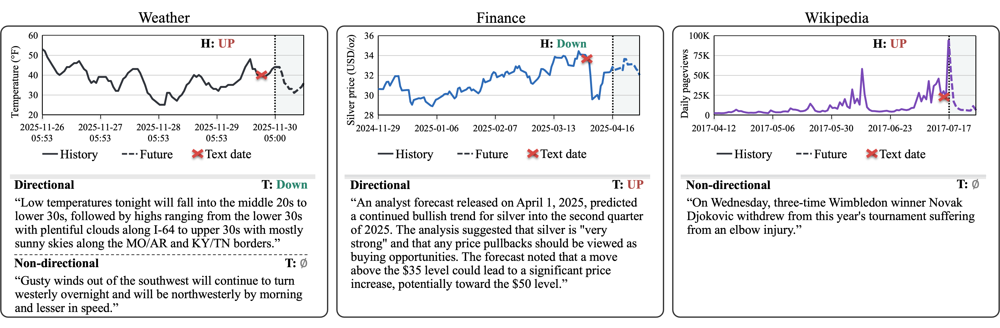

<div align="center">

# *Aligned*, *Conflicting*, or *Unspecified*?

### A Diagnostic Benchmark for Multimodal Time Series Forecasting


[Dataset](#dataset) · [Run](#run)

</div>

## Dataset

`dataset.jsonl` holds **1,762 text–window pairs** over **1,396 numerical windows**. Each pair has 96 historical observations, one text, and 12 future observations.

<p align="center">
  
</p>

<div align="center">

| Domain | Variables | Windows | *Aligned* | *Conflicting* | *Unspecified* | Pairs |
|:---|:---:|:---:|:---:|:---:|:---:|:---:|
| Weather | 5 | 401 | 201 | 165 | 401 | 767 |
| Finance | 64 | 519 | 270 | 249 | – | 519 |
| Wikipedia | 445 | 476 | – | – | 476 | 476 |
| **Total** | **514** | **1,396** | **471** | **414** | **877** | **1,762** |

</div>

## Run

> [!NOTE]
> Requires Linux, Python 3.11, and exactly two NVIDIA Tesla T4 GPUs.

**1. Set up the environments**

```bash
python3.11 -m venv .venv
.venv/bin/python -m pip install -e .
.venv/bin/python scripts/setup_environment.py gpu
.venv/bin/python scripts/setup_environment.py timebraid
```

**2. Run all six models and score them**

```bash
./run.sh outputs results
```

Tables are written to `results/benchmark_results.md` and `results/benchmark_results.tex`. Rerun the same command to resume after an interruption.
